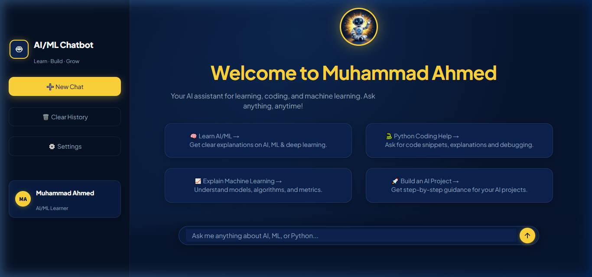

# 🤖 Muhammad Ahmed - AI/ML Chatbot Web Application

A modern, high-aesthetic AI/ML chatbot web application built with **Python & Streamlit**, featuring a dark navy blue (`#07152E`) and vibrant accent yellow (`#FFD43B`) visual design inspired by modern AI dashboard interfaces.




---

## ✨ Design & Features

- 🎨 **Visual Parity & Premium Aesthetic**:
  - Dark Navy primary background (`#07152E`) with rich card blues (`#0F244A`) and glowing accents (`#FFD43B`).
  - Friendly 3D AI Robot mascot waving inside an illuminated yellow circular halo.
  - Custom Google Font typography (**Outfit** & **Inter**) with clean spacing and subtle borders.
- 📱 **Complete Sidebar**:
  - ChatBot branding with glowing robot icon.
  - Active yellow **Home** pill.
  - **New Chat**, **Explore**, **Saved Chats**, and **Settings** navigation.
  - Personalized profile card: `MA Muhammad Ahmed (Free Plan >)`.
  - Inspiring bottom quote with curved golden underline.
- 💡 **Interactive Suggestion Cards (2x2 Grid)**:
  - 💡 **Get Ideas** *(Brainstorm, plan, create)*
  - `</>` **Write Code** *(Debug, build, improve)*
  - 📖 **Learn Something** *(Explain, simplify, explore)*
  - ⚡ **Solve Problems** *(Get clear, actionable answers)*
- 📌 **Right Panel Dashboard**:
  - **Quick Tips**: Best practices for asking detailed prompts.
  - **Popular Prompts**: Clickable quick questions to instantly explore AI/ML.
  - **"Good Vibes Only 🙂"** card with decorative yellow accents.
- 💬 **Conversational Chat Engine**:
  - Azure OpenAI integration with streaming response fallback.
  - Built-in educational knowledge base for offline/demo operation.
  - Rounded pill input composer with custom yellow circular send button.

---

## 🚀 Quick Start

### 1. Install Dependencies
```bash
pip install -r requirements.txt
```

### 2. Configure Environment (`.env`)
Create or edit `.env` in the project root:
```env
AZURE_OPENAI_ENDPOINT=https://<your-resource-name>.services.ai.azure.com/openai/v1/chat/completions
AZURE_OPENAI_API_KEY=your_azure_api_key_here
AZURE_OPENAI_DEPLOYMENT=gpt-4.1-mini
```
*(Note: If credentials are not provided or offline, the app automatically switches to built-in Demo Mode with full educational answers!)*

### 3. Run the Application
You can run it directly with:
```bash
streamlit run app.py
```
Or simply double-click **`run.bat`** on Windows!

The app will be accessible at:
```
http://localhost:8507
```

---

## 📁 Project Structure

```
azure-ai-chatbot-main/
├── .streamlit/
│   └── config.toml        # Streamlit dark navy & yellow theme configuration
├── assets/
│   ├── mascot.jpg         # 3D robot mascot with glowing yellow halo
│   └── preview.png        # Screenshot of the modern UI
├── app.py                 # Main Muhammad Ahmed AI/ML Streamlit application
├── requirements.txt       # Python dependencies (streamlit, requests, python-dotenv)
├── run.bat                # 1-click Windows launcher (runs on port 8507)
├── .env.example           # Template for Azure OpenAI environment keys
├── .gitignore             # Git ignore file
└── README.md              # Project documentation
```

---

## 📄 License
This project is open-source under the [MIT License](LICENSE).

